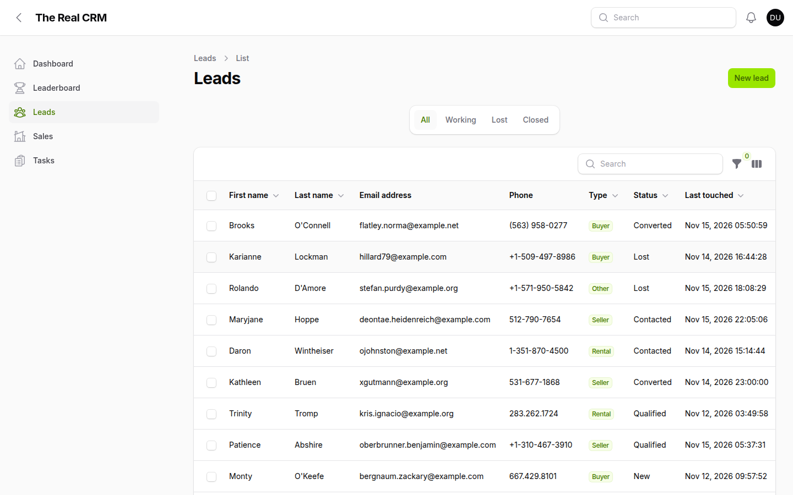
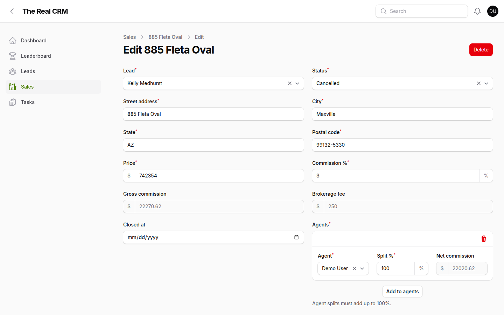

# The Real CRM

[](https://github.com/plwebdesigns/the-real-crm/actions/workflows/ci.yml)
[](LICENSE)


**Live demo:** [https://therealcrm.longoapps.com](https://therealcrm.longoapps.com) (redirects to `/login`)

A Laravel and Filament CRM for a multi-office realty team. Agents work leads and sales in their office, location admins run that office, and a super admin sees the whole firm.

The panel lives at `/`. Sign in at `/login`.

## Screenshots

Agent dashboard: year-to-date sales, commission, pipeline, and assigned leads. The sidebar is Dashboard, Leaderboard, Leads, Sales, and Tasks.


Leads, with All / Working / Lost / Closed tabs.



Sale form. Price and commission percent calculate gross commission, then the brokerage fee, then each agent's net. Seeded sales are one agent at 100%. Splits have to total 100%.



Super admin analytics for every office, with a period and a location filter.


Downtown admin's agent list. All six people are Downtown. Settings for this role is Agents, lead statuses, sale statuses, and lead sources. Locations is on the super admin sidebar.


## Demo accounts

These accounts work on the [live demo](https://therealcrm.longoapps.com/login). All four use **`Password123`**.

| Role | Email | What you should see |
|---|---|---|
| Super admin (firm-wide) | `superadmin@example.com` | All offices. Analytics, Agents, Locations, and lookup settings. Can create location admins and other super admins. |
| Downtown admin | `downtownadmin@example.com` | Downtown only. Analytics and Agents for that office, plus lead/sale status and source settings. |
| Westside admin | `westsideadmin@example.com` | Same as Downtown, scoped to Westside. |
| Agent | `demo@example.com` | Personal dashboard (your sales, commission, and assigned leads). Can create and edit Downtown leads and sales. The sidebar has no Analytics, Agents, or Settings. |

Seeded sample data: **550 leads** and **132 sales** across Downtown and Westside. Each of the 11 office users (the demo agent, both location admins, and 8 filler agents) receives 50 leads and 12 sales.

## Extra seeded agents

`php artisan db:seed` also creates **8 filler agents** (4 Downtown, 4 Westside) with random names and emails. Their password is **`password`**. Emails change when you seed a fresh database.

## What the product does

**Dashboard (everyone)**
Year-to-date closed sales, volume, net commission, pending pipeline, lead counts (assigned / working / lost / closed %), and a "My leads" table. Stats link into the matching Leads or Sales tabs.

**Leads**
Contact plus buyer, seller, rental, or other type, status, source, assigned agents, and property preferences. Tabs: All / Working / Lost / Closed. **Create related lead** copies the person and flips buyer and seller (rental and other stay the same) so one client can be two opportunities, one sale each. Leads keep an activity log and uploaded documents.

**Sales**
One sale per lead. Price and commission percent calculate gross commission, then a **$250 fixed brokerage fee** (`BROKERAGE_FEE` and `BROKERAGE_FEE_TYPE`, fixed or percent), then agent splits that must total 100%. Closed sales require a close date. Sales can hold documents.

**Leaderboard**
Top agents by closed volume for the selected period. A super admin can include every office. Everyone else sees their own office.

**Tasks**
Call, email, and text follow-ups on a lead or sale. `tasks:send-due-reminders` is scheduled every 15 minutes. Reminders are queued (the default queue is `database`): an in-app notification for the assignee, and an email when they have opted in. The default mailer is `log`.

**Analytics (admins)**
Office- or firm-scoped sales and lead totals, a closed-volume chart, per-agent performance, and lead-source revenue. Super admins also get an office comparison and a location filter.

**Settings**
- Super admin: **Locations** (Downtown, Westside).
- Any admin: **Agents**, **Lead statuses**, **Sale statuses**, **Lead sources**.

Location admins manage people in their own office.

**Roles in short**
Agents stay in their office's records. Location admins see that office. The super admin has no office and sees all of them.

## Tech stack

Versions below are the ones locked in `composer.lock` and `package-lock.json`.

| | |
|---|---|
| PHP | 8.4.1+ (`composer.json` requires `^8.4.1`, the same floor as this lockfile). |
| Laravel | 13.29 |
| Filament | 5.7 |
| Livewire | 4.4 |
| Tailwind CSS | 4.3, built with Vite 8.2 |
| Database | MySQL or MariaDB, as in `.env.example`. SQLite works locally. PHPUnit uses in-memory SQLite. |
| Tests and style | PHPUnit 12.5, Laravel Pint 1.30 |

## Engineering notes

**Office scoping.** `User::canAccessLocation()` is the check. `Lead`, `Sale`, `Task`, and `User` expose a `visibleTo` scope, and Filament resources apply it in `app/Filament/Concerns/ScopesRecordsToLocation.php`, so lists never include another office. Policies enforce the same boundary on a single record: `app/Policies/Concerns/AllowsLocationMembers.php` for leads and sales, `app/Policies/UserPolicy.php` for agents, and `app/Policies/Concerns/AllowsSuperAdministrators.php` for locations. A super admin has a null `location_id` and skips the office filter. `tests/Feature/Filament/LocationIsolationTest.php` covers cross-office access.

**Commission.** `Sale::grossCommissionFor()`, `brokerageFeeFor()`, and `remainingCommissionFor()` in `app/Models/Sale.php` turn price and percent into the pool left after the brokerage fee. `SaleUser::netCommissionFor()` in `app/Models/SaleUser.php` writes each agent's net when the pivot is saved. The sale form in `app/Filament/Resources/Sales/Schemas/SaleForm.php` recalculates as you type and rejects splits that do not total 100%. `tests/Feature/Models/SaleTest.php` and `tests/Feature/Filament/SaleResourceTest.php`.

**Analytics.** `app/Filament/Pages/Analytics.php` is limited to admins. Widgets for firm totals, closed volume, offices, lead type, agent performance, and lead source live under `app/Filament/Widgets/`. `tests/Feature/Filament/AnalyticsTest.php`.

## Local setup

You need PHP 8.4.1 or newer (`bcmath`, `ctype`, `curl`, `dom`, `fileinfo`, `intl`, `mbstring`, `openssl`, `pdo`, `tokenizer`, `xml`, `zip`, plus `pdo_sqlite` or `pdo_mysql`), Composer 2, and Node.js 20 or newer.

These steps were run on PHP 8.4: SQLite for the app in the screenshots, and MariaDB for `migrate --seed`.

```bash
git clone https://github.com/plwebdesigns/the-real-crm.git
cd the-real-crm
composer install
npm install
npm run build
cp .env.example .env
php artisan key:generate
```

### SQLite

```bash
touch database/database.sqlite
```

Set these in `.env`. SQLite reads `DB_DATABASE` and ignores `DB_HOST`. `COMPANY_NAME` is the name in the sidebar.

```dotenv
APP_NAME="The Real CRM"
COMPANY_NAME="The Real CRM"
DB_CONNECTION=sqlite
DB_DATABASE=database/database.sqlite
```

```bash
php artisan migrate --seed
php artisan serve
```

Open [http://127.0.0.1:8000/login](http://127.0.0.1:8000/login).

### MySQL or MariaDB

`.env.example` expects a database named `the_real_crm`. On Laravel Herd, user `root` with an empty password is enough, so you can leave the example `DB_*` values and run `php artisan migrate --seed`.

Ubuntu's MariaDB authenticates `root` through the system socket, so that empty password is rejected. Create a user and set `DB_USERNAME` and `DB_PASSWORD` to match:

```sql
CREATE DATABASE the_real_crm CHARACTER SET utf8mb4 COLLATE utf8mb4_unicode_ci;
CREATE USER 'crm'@'127.0.0.1' IDENTIFIED BY 'a-password';
GRANT ALL PRIVILEGES ON the_real_crm.* TO 'crm'@'127.0.0.1';
```

```dotenv
APP_NAME="The Real CRM"
COMPANY_NAME="The Real CRM"
DB_CONNECTION=mysql
DB_HOST=127.0.0.1
DB_PORT=3306
DB_DATABASE=the_real_crm
DB_USERNAME=crm
DB_PASSWORD=a-password
```

```bash
php artisan migrate --seed
php artisan serve
```

### Herd

Herd is optional. Park the project, set `APP_URL` to the `*.test` host Herd assigns, and open that host instead of `php artisan serve`.

### Reset demo data

```bash
php artisan migrate:fresh --seed
```

## Tests

```bash
php artisan test
```

`phpunit.xml` points PHPUnit at an in-memory SQLite database, so the suite does not use the database from `.env`. Format PHP with `vendor/bin/pint`.
